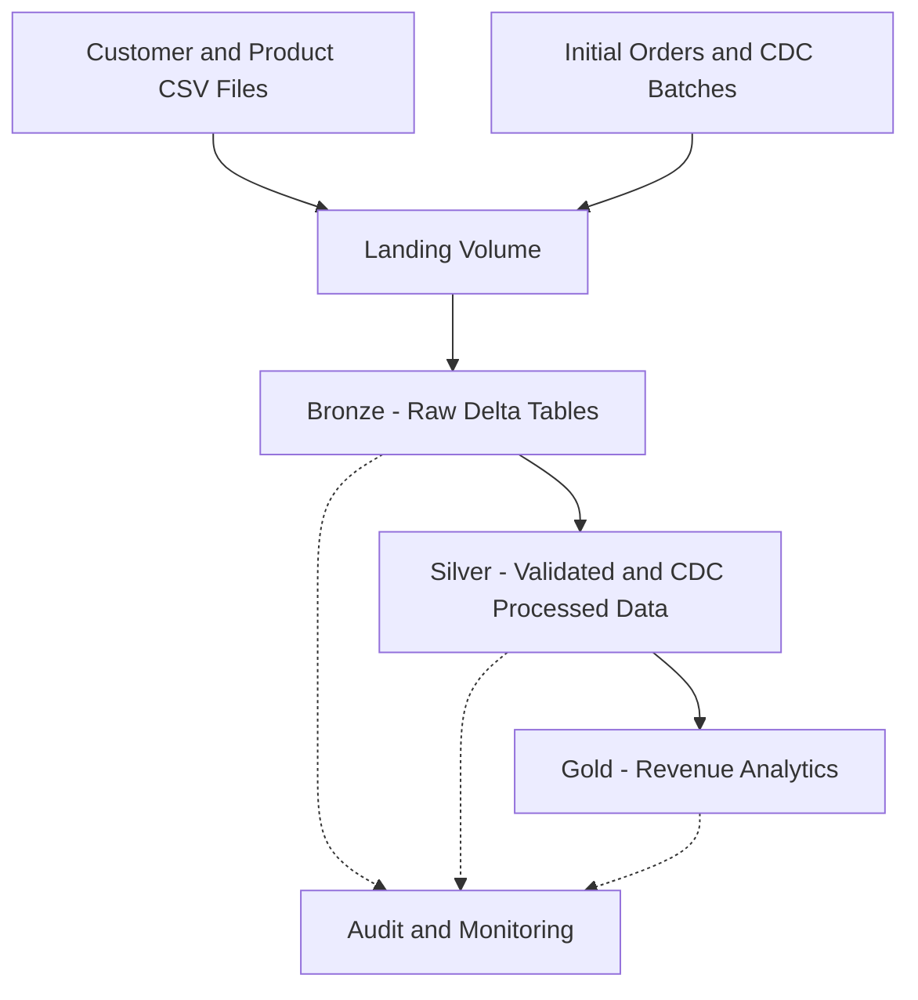

# Retail Order CDC & Revenue Lakehouse

A production-style data engineering project using Databricks,
PySpark, Delta Lake, Unity Catalog and SQL.

The project demonstrates Medallion Architecture, Change Data
Capture (CDC), incremental processing, data quality,
replay-safe ingestion and retail revenue analytics.

**Current milestone:** Bronze Layer — Implemented and Validated

---

## Project Overview

Retail businesses continuously generate customer, product
and order data. Orders may be inserted, updated, cancelled,
completed or deleted throughout their lifecycle.

The objective of this project is to build a reliable
lakehouse pipeline that processes these changes accurately,
preserves source history and delivers trusted datasets
for business analytics.

## Business Requirements

- Maintain accurate customer, product and order data.
- Process incremental order changes using CDC.
- Prevent duplicate ingestion during pipeline reruns.
- Preserve source event history for traceability.
- Handle invalid, duplicate and late-arriving events.
- Maintain the latest valid order state.
- Deliver accurate retail revenue analytics.

### Business Rules

- Only COMPLETED, non-deleted orders contribute to revenue.
- Revenue = Quantity × Historical Order Unit Price.
- Deleted orders are handled through soft deletes in Silver.
- CDC ordering prioritizes event_sequence, followed
  by event_timestamp.
- Older events must not overwrite newer order states.
- Revenue is calculated from the latest valid order state,
  not by summing historical CDC events.

These rules define the intended Silver and Gold behavior.

---

## Technology Stack

| Technology | Purpose |
|---|---|
| Databricks Free Edition | Lakehouse platform |
| Serverless Compute | Pipeline execution |
| Apache Spark | Distributed data processing |
| PySpark | Data ingestion and transformation |
| Spark SQL | Validation and analytics |
| Delta Lake | Transactional data storage |
| Unity Catalog | Data organization and governance |
| Unity Catalog Volumes | Source file storage |
| Databricks Jobs | Planned orchestration |
| Git and GitHub | Version control and documentation |

**Validated Spark version:** 4.2.0

---

## Solution Architecture



| Layer | Responsibility | Status |
|---|---|---|
| Landing | Source files and CDC batches | Completed |
| Bronze | Source ingestion and metadata | Validated |
| Silver | Data quality and CDC processing | Planned |
| Gold | Revenue and business analytics | Planned |
| Audit | Execution metrics and monitoring | Planned |

---

## Unity Catalog Structure

```text
retail_poc2
├── landing
│   └── source_files (Volume)
├── bronze
│   ├── customers_raw
│   ├── products_raw
│   ├── orders_raw
│   └── orders_cdc_raw
├── silver
├── gold
└── audit
```

The catalog, five schemas, landing Volume and four
Bronze managed Delta tables have been created.

---

## Source Data

| Dataset | Records |
|---|---:|
| Customers | 100 |
| Products | 30 |
| Initial Orders | 500 |
| CDC Batch 001 | 5 |
| CDC Batch 002 | 5 |
| CDC Batch 003 | 5 |
| **Total** | **645** |

CDC operations:

- I — Insert
- U — Update
- D — Delete

Additional test datasets:

| Test Dataset | Records |
|---|---:|
| duplicate_events.csv | 2 |
| invalid_orders.csv | 2 |
| late_arriving_events.csv | 1 |

The test datasets have been validated for readability.
Business-level scenario testing is planned for Silver.

---

## Implementation Roadmap

| Phase | Milestone | Status |
|---|---|---|
| Phase 0 | Architecture and business requirements | Completed |
| Phase 1 | Environment and CDC validation | Completed |
| Phase 2 | Bronze ingestion and testing | Completed |
| Phase 3 | Silver CDC and data quality | Planned |
| Phase 4 | Gold revenue analytics | Planned |
| Phase 5 | Audit and orchestration | Planned |
| Phase 6 | End-to-end testing and optimization | Planned |

---

## Phase 0 — Architecture and Design

**Status: Completed**

Key deliverables:

- Medallion Architecture design
- Retail business requirements
- Revenue calculation rules
- Source data contracts
- CDC ordering strategy
- Soft-delete strategy
- GitHub repository initialization

Documentation:

- [Architecture](docs/architecture.md)
- [Data Contract](docs/data_contract.md)

---

## Phase 1 — Environment and CDC Validation

**Status: Completed and Validated**

### Implementation

- Unity Catalog and Volume configuration
- Spark SQL and Delta API validation
- Source file discovery and schema inspection
- Source record count validation
- CDC operation and sequence validation
- Duplicate event ID detection
- Ordering conflict detection
- Databricks Git integration

### Validation Results

| Validation | Result |
|---|---|
| Environment validation | PASS |
| Source file validation | PASS |
| CDC operation validation | PASS |
| CDC ordering validation | PASS |
| Duplicate CDC event IDs | 0 |
| Equal-sequence and timestamp collisions | 0 |
| Null ordering fields | 0 |
| CDC events older than or equal to matching initial state | 0 |

Initial order sequence range: 1001–1500

CDC event sequence range: 2001–2015

Results apply to the regular source datasets.

Documentation and implementation:

- [Validation Results](docs/validation_results.md)
- [Environment Validation Notebook](Notebooks/00_validate_environment.ipynb)
- [CDC Ordering Validation Notebook](Notebooks/01_validate_cdc_ordering.ipynb)

---

## Phase 2 — Bronze Layer Implementation

**Status: Completed and Validated**

### Implementation

- Explicit PySpark source schemas
- DECIMAL(18,2) for financial precision
- LongType for sequence numbers
- CSV header and price precision validation
- FAILFAST parsing
- Reusable ingestion functions
- Source file metadata and SHA-256 record hashing
- Unity Catalog managed Delta tables
- Replay-safe insert-only Delta MERGE
- Full parsed-record reconciliation
- Idempotency testing using Delta Time Travel

### Ingestion Metadata

| Column | Purpose |
|---|---|
| _source_file | Source file path |
| _source_file_name | Source filename |
| _ingestion_timestamp | Ingestion processing time |
| _record_hash | SHA-256 hash of parsed business values |

### Validated Results

| Bronze Table | Records | Reconciliation | Replay Test |
|---|---:|---|---|
| customers_raw | 100 | PASS | PASS |
| products_raw | 30 | PASS | PASS |
| orders_raw | 500 | PASS | PASS |
| orders_cdc_raw | 15 | PASS | PASS |
| **Total** | **645** | **PASS** | **PASS** |

### Data Integrity and Replay Results

| Metric | Result |
|---|---:|
| Source records | 645 |
| Target records | 645 |
| Missing records | 0 |
| Unexpected records | 0 |
| Duplicate ingestion identity groups | 0 |
| Invalid metadata records | 0 |
| Additional records after replay | 0 |
| Existing records modified after replay | 0 |
| Reconciliation tests passed | 4/4 |
| Idempotency tests passed | 4/4 |

### Idempotency Strategy

The Bronze ingestion identity combines the source file
path and SHA-256 record hash.

An insert-only Delta MERGE prevents previously ingested
identities from being inserted again.

The pipeline successfully reprocessed all 645 source
records without adding, removing or modifying existing
target records.

Delta Time Travel was used to compare the original
version 1 snapshots with the latest table state.

### Engineering Challenge

The initial table creation encountered an unsupported
errorifexists write mode in the Serverless Spark
Connect environment.

The empty-table initialization was changed to
mode("ignore"), while retaining the insert-only
Delta MERGE strategy.

All four tables were subsequently created, populated
and validated successfully.

Documentation and implementation:

- [Bronze Implementation and Test Results](docs/bronze_implementation.md)
- [Bronze Ingestion Notebook](Notebooks/02_bronze_ingestion.ipynb)

---

## Engineering Practices

This project demonstrates:

- Business-driven data engineering
- Medallion Architecture
- Explicit schema management
- Financial data precision
- Transactional Delta storage
- Source data traceability
- Sequential replay safety
- Source-to-target reconciliation
- Reusable pipeline functions
- Regression and idempotency testing
- Version-controlled development
- Phase-wise implementation and validation
- Documentation of actual execution results

---

## Repository Structure

```text
retail-order-cdc-revenue-lakehouse/
├── docs/
│   ├── architecture.md
│   ├── data_contract.md
│   ├── validation_results.md
│   └── bronze_implementation.md
├── Notebooks/
│   ├── 00_validate_environment.ipynb
│   ├── 01_validate_cdc_ordering.ipynb
│   └── 02_bronze_ingestion.ipynb
├── README.md
├── .gitignore
└── LICENSE
```

---

## Execution Instructions

### Prerequisites

- Databricks workspace with Serverless compute
- Unity Catalog access
- Required catalog, schemas and Volume
- Source CSV files uploaded to the landing Volume
- Permissions to create and modify Delta tables

### Source Location

```text
/Volumes/retail_poc2/landing/source_files/
├── initial/
├── CDC/
└── test_cases/
```

### Notebook Execution Order

1. 00_validate_environment
2. 01_validate_cdc_ordering
3. 02_bronze_ingestion

Review the validation results after each notebook execution.

Source datasets and Unity Catalog resources must currently
be provisioned separately in the target workspace.

---

## Design Assumptions and Limitations

- The project uses a small demonstration dataset.
- Source files are assumed to be immutable.
- Pipeline execution is assumed to be sequential.
- Bronze preserves parsed values rather than original CSV bytes.
- Identical ingestion identities within the same source
  dataset cause ingestion to fail.
- Delta transactions are independent for each target table.
- Cross-table atomicity is not implemented.
- Concurrent execution and partial-failure recovery are untested.
- Persistent audit logging and orchestration are pending.
- Silver and Gold processing are pending.
- Large-scale performance testing is pending.
- Fully automated environment provisioning is pending.

This is a production-style learning project, not a
production-certified system.

---

## Next Milestone — Silver Layer

Planned implementation:

- Customer and product data validation
- Business-level data quality rules
- CDC deduplication
- Sequence-based CDC processing
- Delta MERGE upserts
- Soft-delete handling
- Late-arriving event handling
- Invalid record quarantine
- Silver reconciliation
- CDC replay and regression testing

---

## License

This project is licensed under the MIT License.

See the [LICENSE](LICENSE) file for details.
